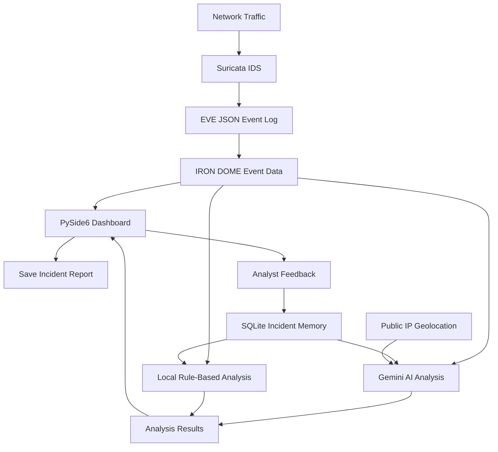

# IRON DOME — System Architecture and Methodology

## 1. Introduction

IRON DOME is a Python-based network security monitoring prototype that combines Suricata intrusion detection telemetry, a PySide6 graphical user interface, Google Gemini AI-assisted analysis, and persistent incident memory.

The system is designed to help an analyst inspect network security events, review historical incidents, assess potential threats, and generate incident reports.

The architecture separates event monitoring, presentation, analysis, data persistence, and external service integration into logical components within the Python application.

## 2. System Architecture

IRON DOME consists of the following logical components:

1. **Network Monitoring Layer:** Suricata observes traffic visible to its configured network interface and produces security events.
2. **Event Processing Layer:** The application uses available event metadata, including timestamps, source and target IP addresses, severity, and event signatures.
3. **Graphical User Interface:** PySide6 displays monitoring information, analysis results, and incident-related controls.
4. **AI Analysis Layer:** Google Gemini processes selected real-event metadata, available IP-region information, and historical incident context.
5. **Offline Analysis Layer:** A local rule-based analysis function provides a fallback when online Gemini analysis is unavailable.
6. **Incident Memory Layer:** SQLite stores real-event metadata and analyst feedback for historical comparison.
7. **IP Enrichment Layer:** A public IP geolocation service provides approximate region information for eligible public IP addresses.
8. **Reporting Layer:** The application allows analysis output to be saved as a text incident report.

## 3. Architecture Diagram



*The diagram represents the logical processing architecture. Exact event-reading mechanisms and deployment configuration depend on the application setup.*

## 4. Component Description

### 4.1 Network Monitoring — Suricata

Suricata is the intrusion detection component responsible for inspecting traffic visible to the configured sensor and evaluating it against its enabled rules.

Depending on its configuration and the observed traffic, Suricata can produce events associated with suspicious connections, reconnaissance, protocol anomalies, and other rule-matched activity.

The EVE JSON output format provides structured event records that can include fields such as:

- Timestamp
- Source IP address
- Destination IP address
- Alert signature
- Severity or priority
- Event type
- Protocol and port information, when available

Suricata's visibility depends on sensor placement, network configuration, and enabled rules. It cannot detect traffic that it never observes.

### 4.2 Event Processing

IRON DOME uses event metadata to organize and analyze security activity.

The analysis workflow distinguishes real event records from simulated demonstration events. Demo events are excluded from the Gemini assessment and incident-memory learning workflow.

The Gemini analysis component considers up to the most recent 80 real events supplied to it. It extracts selected metadata and prepares a structured JSON representation for analysis.

The available metadata is evidence for investigation, not proof that a host has been compromised.

### 4.3 Graphical User Interface — PySide6

The desktop interface is implemented using PySide6 and Qt.

Its responsibilities include:

- Displaying security monitoring information.
- Presenting local analysis and Gemini analysis results.
- Providing Gemini API-key settings.
- Displaying analysis status and error messages.
- Allowing analyst feedback to be recorded.
- Saving generated incident reports.

The Gemini analysis task runs in a worker thread so that a network request does not need to execute directly in the main GUI thread. The interface can also display local analysis when the online request fails.

### 4.4 Google Gemini AI Analysis

The AI analysis component sends selected security-event metadata to the Google Gemini API using Python's standard HTTP and JSON libraries.

The request includes:

- The protected host address supplied to the analysis.
- Selected real Suricata event metadata.
- Available approximate public IP-region information.
- A summary of persistent incident memory.
- Instructions to distinguish evidence from inference and provide defensive recommendations.

The intended output is organized into sections such as:

- Summary
- IP Region Analysis
- Historical Comparison
- Risk Assessment
- Evidence
- Recommended Defensive Actions
- Limitations

Gemini is used as an analysis assistant. It does not replace Suricata's detection engine, independently verify all network activity, or prove that a suspected attack succeeded.

### 4.5 Local Rule-Based Analysis

IRON DOME includes a local analysis function that can produce a preliminary assessment without relying on a successful Gemini API request.

The local analysis examines available event metadata, including signature frequency, source frequency, severity counts, and scan-related keywords.

It produces an evidence-oriented summary and suggested defensive actions.

This fallback is a lightweight rule-based process, not a trained machine-learning model. Its conclusions are limited by the metadata available to the application.

### 4.6 IP-Region Enrichment

During Gemini analysis, the application attempts to retrieve approximate public IP-region information for up to eight distinct source IP addresses.

The lookup can return fields such as country, region, city, timezone, and ISP when supported by the service.

Private, loopback, link-local, and reserved addresses are not suitable for ordinary public geolocation lookup.

IP-region data has important limitations:

- Results can be inaccurate or outdated.
- VPNs, proxies, and hosting providers can affect apparent location.
- Geolocation does not establish the identity of an attacker.
- A geographic location is not proof of malicious activity.

### 4.7 Persistent Incident Memory

SQLite provides local storage for incident history and analyst feedback.

The database is stored under the user's home directory in:

```text
~/.iron_dome/incident_memory.sqlite3
```

The database records fields including event time, source IP, target IP, severity, signature, and feedback.

The application uses a stable event key and an insert-if-absent operation to reduce duplicate incident records.

Simulated demonstration events are excluded from persistent incident learning.

Historical records are summarized for subsequent analysis. This is a feedback-informed workflow; it does not mean the system retrains a machine-learning model automatically.

### 4.8 Analyst Feedback

The interface supports explicit analyst labels:

- `TRUE_POSITIVE`
- `FALSE_POSITIVE`

The analyst confirms the selected label before it is saved. Feedback is associated with the real events in the current session.

Future analysis can use these labels as historical context. The accuracy of that context depends on analysts reviewing events carefully and assigning correct labels.

### 4.9 Incident Reporting

The reporting workflow allows the displayed analysis text to be saved as a text file.

Reports can support investigation records, project demonstrations, and documentation of observed security activity.

Reports should distinguish observed event data, analytical interpretation, and recommended actions. An AI-generated assessment should not be represented as independently verified forensic evidence.

## 5. Methodology

The project follows a layered monitoring and analysis methodology.

### Phase 1 — Sensor Configuration

Install and configure Suricata on a system capable of observing the target traffic.

Enable the required rules and configure the event output. Validate the configuration before starting the monitoring service.

**Output:** A functioning IDS sensor and structured security-event output.

### Phase 2 — Event Collection

Generate or observe network traffic in an authorized test environment.

Suricata evaluates the traffic using its enabled detection rules and writes the resulting events to its configured output.

**Output:** Structured event records describing observed activity.

### Phase 3 — Event Presentation and Selection

Make available event metadata accessible to the application and display the relevant information in the interface.

Separate simulated demonstration data from real events so that demonstration contacts are not mistaken for actual detections.

**Output:** A reviewable set of security-event metadata.

### Phase 4 — Preliminary Local Assessment

Use the local rule-based analysis function to summarize event frequencies, signatures, source addresses, and available severity information.

This provides a basic assessment that remains available if the Gemini API cannot be reached.

**Output:** A preliminary evidence-based summary.

### Phase 5 — Historical Context

Persist real event metadata in SQLite and retrieve summaries of prior events and verified analyst feedback.

Use the historical information to help identify recurring signatures and previously labelled patterns.

**Output:** Historical context for subsequent analysis.

### Phase 6 — IP-Region Enrichment

Attempt public IP-region lookups for eligible source addresses.

Include returned information in the online analysis request where available. Do not treat a missing lookup result as evidence of maliciousness.

**Output:** Optional geographic and network-provider context.

### Phase 7 — Gemini Analysis

Submit the selected real-event metadata, IP-region information, and incident-memory summary to the configured Gemini model.

Receive the generated assessment and present it in the GUI. If the request fails, display the local analysis fallback and the available error information.

**Output:** An AI-assisted incident assessment or a local fallback report.

### Phase 8 — Human Review and Feedback

The analyst reviews the alert evidence and analysis, verifies the relevant signatures and timestamps, and assigns feedback only when sufficient evidence is available.

The analyst should not classify an event as malicious solely because an AI model recommends a high risk level.

**Output:** Reviewed incident labels and improved historical context.

### Phase 9 — Report Generation

Save the displayed assessment as a text report for later review and project documentation.

**Output:** A persistent report of the analysis performed.

## 6. End-to-End Data Flow

The normal analysis workflow can be summarized as follows:

1. Network traffic reaches the Suricata sensor.
2. Suricata evaluates observable traffic using its configured rules.
3. Security events are produced in structured output.
4. IRON DOME uses the available event metadata.
5. Local analysis and incident-history functions summarize relevant observations.
6. The Gemini workflow optionally enriches eligible public IP addresses.
7. Selected real-event metadata and historical context are submitted to Gemini.
8. The result is displayed in the application, or local fallback analysis is shown if the request fails.
9. The analyst reviews the evidence and may record feedback.
10. The analysis can be saved as a text report.

## 7. Security and Privacy Considerations

- API keys must not be hard-coded into the source or committed to version control.
- Keyring storage is optional; the environment-variable fallback is not equivalent to persistent secure credential storage.
- Event metadata sent to Gemini leaves the local system and is processed by an external service. Avoid transmitting sensitive information without appropriate authorization.
- Public IP-region lookups also send eligible public IP addresses to an external provider.
- Incident databases and reports can contain sensitive network information and should be protected.
- Event fields must be treated as untrusted input.
- AI-generated output must be validated against event evidence.
- Automatic IP blocking is not performed by the Gemini analysis workflow described here.

## 8. Testing and Evaluation Methodology

The system should be evaluated in an isolated, authorized lab.

### 8.1 Functional Testing

Verify that:

- The application starts successfully.
- The GUI remains responsive during online analysis.
- Gemini settings accept and test a configured API key.
- Local fallback analysis is shown when online analysis is unavailable.
- Incident reports can be saved.
- Analyst feedback can be recorded and retrieved through historical summaries.

### 8.2 Event-Handling Testing

Generate controlled, authorized network activity and compare the resulting observations with Suricata's event output.

Check timestamps, source and target addresses, signatures, and severity values where available.

Do not assume that all port scans, denial-of-service attempts, or suspicious connections will generate an alert. Detection depends on the rules, configuration, traffic visibility, and test conditions.

### 8.3 Incident-Memory Testing

Verify that real events are stored, repeated inserts do not create duplicate records for the same event key, and simulated events are excluded from persistent learning.

Check that analyst labels are saved only after explicit confirmation.

### 8.4 AI Integration Testing

Test successful requests, invalid API keys, unsupported model identifiers, unavailable network connections, and API quota errors.

Confirm that the application reports failures and falls back to local analysis without claiming that the Gemini analysis succeeded.

### 8.5 Performance Testing

Observe application responsiveness, event-processing delay, memory usage, API response time, and database activity under controlled workloads.

Record test conditions and measured results rather than assuming a particular detection rate or performance level.

## 9. Current Scope and Limitations

IRON DOME is a monitoring and AI-assisted analysis prototype.

Its capabilities are bounded by:

- The traffic visible to the Suricata sensor.
- The enabled Suricata rules and output configuration.
- The event metadata supplied to the application.
- Gemini API availability and model support.
- The accuracy of public IP-region information.
- The quality of stored analyst feedback.

The architecture does not establish that every attack will be detected, that a suspected host is compromised, or that malicious traffic will automatically be blocked.

## 10. Future Enhancements

Potential future improvements include:

- More robust event ingestion and validation.
- Configurable event retention and database maintenance.
- Improved filtering, search, and report export.
- Additional metrics for detection quality and performance.
- More comprehensive test datasets and repeatable evaluation.
- Configurable, explicitly authorized response actions with safeguards.
- Improved deployment support for Raspberry Pi and Linux sensor environments.

## Conclusion

IRON DOME brings together network intrusion detection, desktop visualization, local incident history, analyst feedback, public IP-region enrichment, and Gemini-assisted security analysis in a single project workflow.

Its purpose is to help analysts organize security evidence and investigate suspicious activity while keeping human verification central to defensive decisions.
